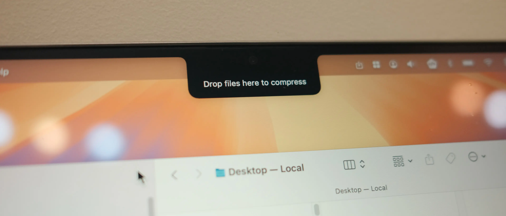
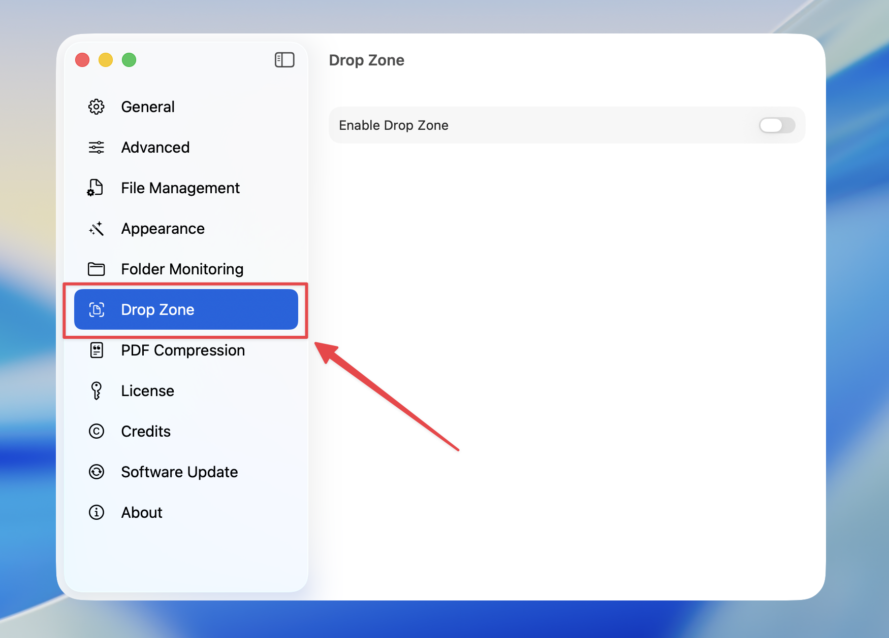
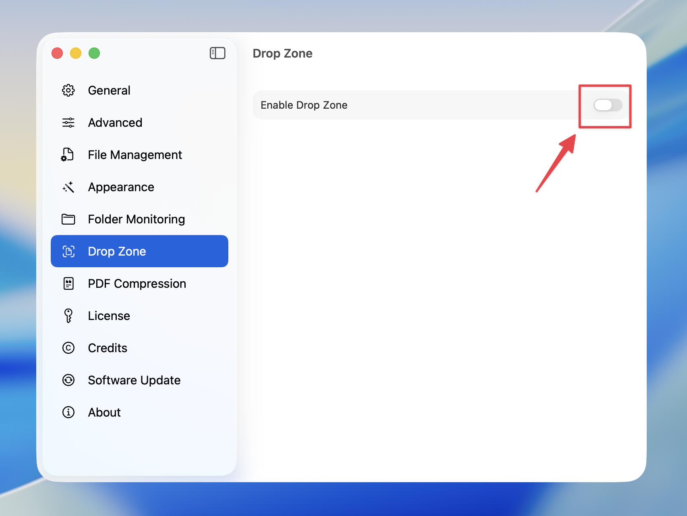
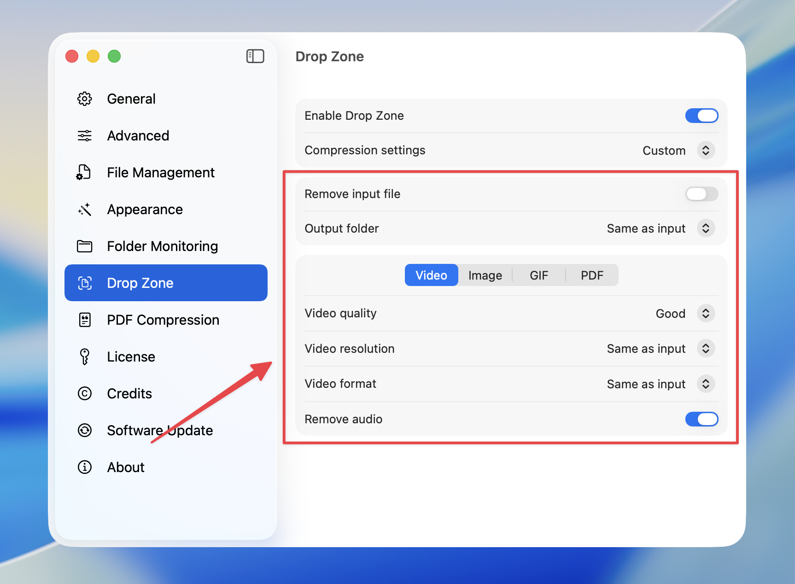

## Overview

Drop Zone provides a quick way to compress files by dragging and dropping them onto a designated area that appears near your Mac's notch (or top of screen). When you drag supported files near the notch, the Drop Zone appears, ready to receive your files for compression.

## Supported File Types

- **Video** - mp4, mov, webm, and other video formats
- **Image** - jpg, png, webp, and other image formats
- **GIF** - Animated GIF files
- **PDF** - PDF documents (requires [Ghostscript](/guides/getting-started/install-ghostscript))
- **EPUB** - Ebooks ([learn more](/guides/file-compression/how-to-compress-epub))
- **Folders** - Every supported file inside, including subfolders

## Getting Started

<Steps>
  <Step>
    Open the Settings window and choose the **Drop Zone** tab
    
  </Step>
  <Step>
    Toggle on **Enable Drop Zone** to enable the feature
    
  </Step>
  <Step>
    Customize compression settings for Drop Zone
    
  </Step>
  <Step>
    Drag files to the Drop Zone to start compression

    
  </Step>
</Steps>

## Drop Zone Mode

| Mode | Description |
|------|-------------|
| **Compress** | Drop files to compress them right away (default) |
| **Compress & Open in App** | The Drop Zone splits into two halves: drop on **Compress** to compress right away, or on **Open in App** to load the files into the main window so you can adjust settings first |

## Dropping Folders

Drop a whole folder to compress every supported file inside it, including files in subfolders. Hidden files are skipped. The Drop Zone only appears for folders that contain at least one supported file.

## Configuration Options

### Compression Settings Type

| Option | Description |
|--------|-------------|
| **Last used settings** | Uses the same settings as the main window (default). If the main window is set to [Mirror folder](/guides/file-compression/output-options#mirror-folder), files go straight into the mirror destination without recreating folders |
| **Custom** | Configure separate settings specifically for Drop Zone |
| **Preset** | Uses a saved [compression preset](/customization/presets). Output folder and **Remove input file** still come from the main window |

<Note>
Drop Zone settings are also used by [clipboard compression](/customization/clipboard-compression).
</Note>

### Video Settings

When using custom settings, you can configure:

- **Video quality**: highest, high, good, medium, acceptable
- **Video resolution**: same as input, 4K, Full HD, HD, max width, max height, max long edge, max short edge
- **Video format**: same, mp4, webm, mov
- **Remove audio**: Strip audio track from videos

### Image Settings

- **Image quality**: highest, high, good, medium, acceptable
- **Image format**: same, jpg, png, webp, avif
- **Image size**: same as input, percentage, max width, max height, max long edge, max short edge

### GIF Settings

- **GIF quality**: highest, high, good, medium, acceptable
- **GIF dimension**: same as input, 75%, 50%, 25%, custom percentage, or max width

### PDF Settings

- **PDF quality**: best, high, balance, low

### EPUB Settings

- **EPUB quality**: best, high, balance, low

### Output Settings

#### Remove Input File

Enable to automatically delete the original file after compression.

#### Output Folder

| Option | Description |
|--------|-------------|
| **Same as input** | Save compressed files in the same folder as input |
| **Subfolder** | Save to a subfolder (default: "compressed") |
| **Custom** | Choose a specific output folder |

## Rename the Output

When a single file finishes compressing, click the pencil icon next to its name in the notch to rename it. Press **Return** to save or **Esc** to cancel. This requires the **Expanded** dynamic island style (**Settings** > **Appearance**).

<Note>
[Finder tags](/customization/file-metadata#adding-finder-tags) you set in **Settings** > **File Management** are applied to Drop Zone output too.
</Note>
