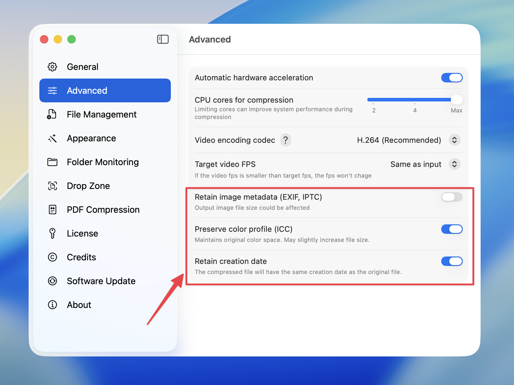

## Overview

By default, Compresto strips metadata from files during compression to achieve smaller file sizes. However, you can choose to preserve various types of metadata when needed.

## Available Options

### Retain Image Metadata (EXIF, IPTC)

Preserves camera and photo information embedded in your images, including XMP data. Compresto copies the metadata onto the compressed file without recompressing it again, so your quality and resize settings stay intact.

**EXIF data includes:**
- Camera make and model
- Date and time the photo was taken
- Exposure settings (aperture, shutter speed, ISO)
- GPS location (if available)
- Lens information

**IPTC data includes:**
- Copyright information
- Author/creator details
- Keywords and captions
- Location descriptions

<Warning>
Enabling this option may increase output file size. Metadata is kept for JPEG, PNG, and TIFF output, and isn't kept when you compress an image to a target file size.
</Warning>

### Preserve Color Profile (ICC)

Maintains the original color space of your images. This is important for:

- Professional photography workflows
- Print production
- Color-accurate displays
- Images with specific color gamuts (Adobe RGB, ProPhoto RGB, Display P3)

<Note>
Preserving color profiles may slightly increase file size but ensures colors display correctly across different devices.
</Note>

### Retain Creation Date

Keeps the original file creation date on the compressed output. Without this option, compressed files will have the current date as their creation date. Folders that Compresto recreates in the output (for example when compressing a folder with subfolders) keep their original dates too.

### Retain Modification Date

Keeps the original file's modification date on the compressed output, so files stay in the same order when sorted by **Date Modified**.

Useful for:
- Maintaining photo library organization
- Preserving chronological order in file managers
- Archival purposes

## How to Configure

<Steps>
  <Step>
    Open Compresto
  </Step>
  <Step>
    Go to **Settings** > **Advanced**
  </Step>
  <Step>
    Toggle the metadata options you want to preserve:
    - **Retain image metadata (EXIF, IPTC)**
    - **Preserve color profile (ICC)**
    - **Retain creation date**
    - **Retain modification date**

    
  </Step>
</Steps>

## Always Preserved

These are kept automatically, with no setting needed:

- **Print resolution (DPI)**: JPEG and PNG output keeps the original DPI, so compressed images place at the same size in layout apps like InDesign or Affinity Publisher
- **Finder tags**: Tags on the original file are copied to the compressed file

## Adding Finder Tags

To tag every compressed file, go to **Settings** > **File Management** and turn on **Apply Finder tags to compressed files**. Type a tag and press **Add**, or pick from **Your Finder tags**. These tags are added on top of the original file's tags, and names that match existing macOS tags use the same color.

Custom tags apply to files compressed from the main window, Drop Zone, and folder monitoring.

## When to Use

| Scenario | Recommended Settings |
|----------|---------------------|
| Maximum compression | All options off |
| Photography archive | All options on |
| Social media sharing | All options off (platforms strip metadata anyway) |
| Print production | Preserve color profile on |
| Organized photo library | Retain creation date and modification date on |
| Print layout | Nothing to change — DPI is kept automatically |
