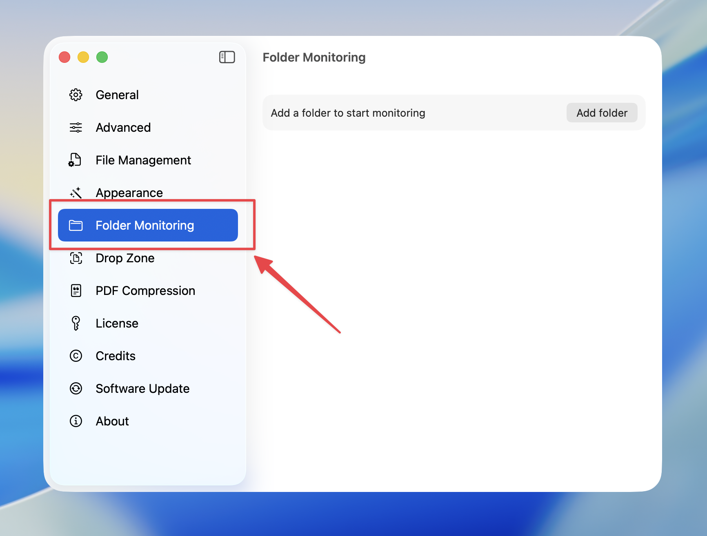
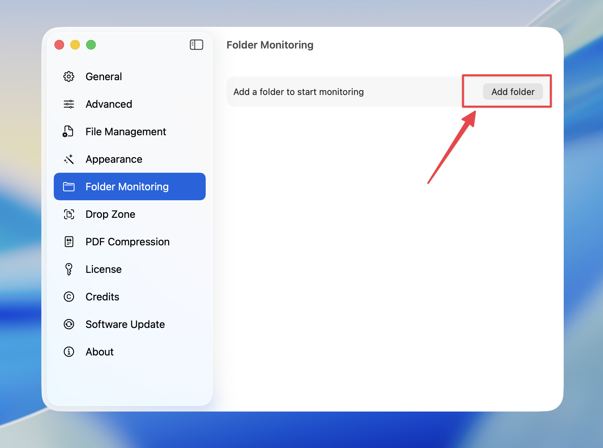
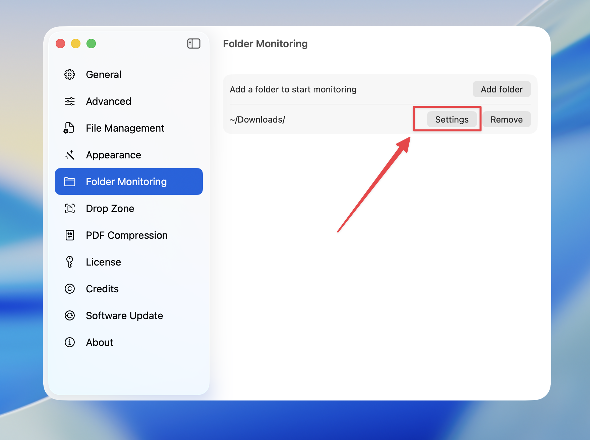
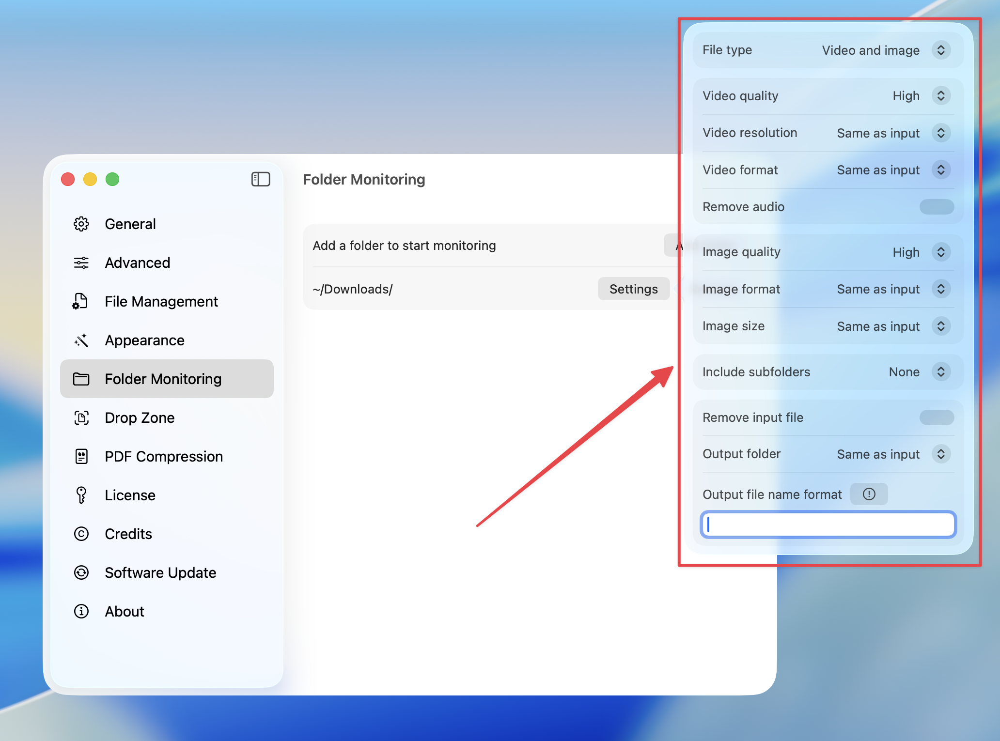
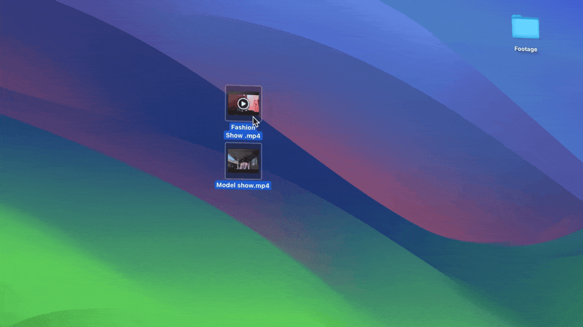

## Overview

Folder monitoring allows Compresto to automatically compress files when they are added to specified folders. This is useful for automating compression workflows.

## Getting Started

<Steps>
  <Step>
    Open the Settings window and choose the **Folder Monitoring** tab
    
  </Step>
  <Step>
    Press **Add folder** to add the folder you want to monitor
    
  </Step>
  <Step>
    Once the folder is added, press **Settings** to customise the compression settings for that folder
    
  </Step>
  <Step>
    Configure your compression settings
    
  </Step>
  <Step>
    Whenever a new file is added to the folder, Compresto will automatically compress it
    
  </Step>
</Steps>

## Configuration Options

### File Type

Choose which file types to monitor and compress:

| Option | Description |
|--------|-------------|
| **Image** | Only compress image files |
| **Video** | Only compress video files |
| **Video and image** | Compress both video and image files (default) |

<Note>
Folder monitoring handles images and videos only. GIF, PDF, and EPUB files in a monitored folder are ignored. Hidden files and in-progress Chrome downloads (`.crdownload`) are skipped too.
</Note>

### Wait for File to Finish Writing

Large downloads, exports, and network transfers can arrive in pieces. Set **Wait for file to finish writing** (0–60 seconds) and Compresto waits until the file size stays the same for that long before compressing it. Type a value and press **Update**.

The default is **0**, which compresses new files right away.

<Tip>
Use 2–5 seconds for folders that receive files over the network or from apps that write in chunks.
</Tip>

### Video Settings

- **Video quality**: highest, high, good, medium, acceptable
- **Video resolution**: same as input, 4K, Full HD, HD, max width, max height, max long edge, max short edge
- **Video format**: same, mp4, webm, mov
- **Remove audio**: Strip audio track from videos

### Image Settings

- **Image quality**: highest, high, good, medium, acceptable
- **Image format**: same, jpg, png, webp, avif
- **Image size**: same as input, percentage, max width, max height, max long edge, max short edge

### Subfolder Processing

Use **Include subfolders** to control how deep Compresto watches:

| Option | Description |
|--------|-------------|
| **None** | Only monitor the selected folder (default) |
| **Custom** | Monitor subfolders up to a **Max depth** you set |
| **All** | Monitor all subfolders, at any depth |

### Output Settings

#### Remove Input File

Enable to automatically delete the original file after compression.

#### Output Folder

| Option | Description |
|--------|-------------|
| **Same as input** | Save compressed files in the same folder as input |
| **Subfolder** | Save to a subfolder (default: "compressed") |
| **Custom** | Choose a specific output folder |

#### Output File Name Format

Customize the output file name using these variables:

| Variable | Description |
|----------|-------------|
| `{timestamp}` | Current unix timestamp |
| `{datetime}` | Date and time in "yyyy-MM-dd'T'HHmmss" format |
| `{date}` | Date in "yyyy-MM-dd" format |
| `{time}` | Time in "HHmmss" format |
| `{quality}` | Quality of the output file |
| `{resolution}` | Resolution of the output file |

Leave the field empty to use the global file name format.

<Note>
Each monitored folder can have its own independent compression settings.
</Note>

## Clipboard Compression

The **Folder Monitoring** tab also has **Auto-compress clipboard contents**, which compresses files and images as soon as you copy them. See [Clipboard compression](/customization/clipboard-compression).
