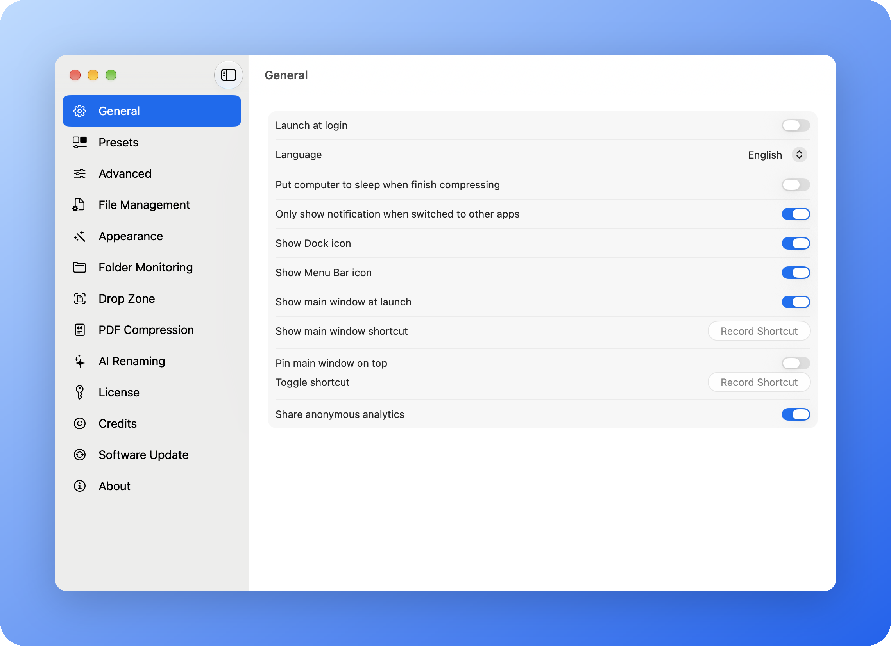

## General

Open **Settings** > **General** (**⌘,**).

| Setting | What it does |
|---------|--------------|
| **Launch at login** | Opens Compresto when you log in to your Mac |
| **Language** | Changes the app language ([learn more](/customization/language)) |
| **Put computer to sleep when finish compressing** | Sleeps your Mac after a batch ([learn more](/customization/sleep-after-compression)) |
| **Only show notification when switched to other apps** | Skips the success notification while Compresto is in front ([learn more](/customization/notifications)) |
| **Show Dock icon** | Shows Compresto in the Dock |
| **Show Menu Bar icon** | Shows the Compresto icon in the menu bar |
| **Show main window at launch** | Opens the main window when Compresto starts. Turn it off to start in the background, for example with Drop Zone or folder monitoring |
| **Show main window shortcut** | A global keyboard shortcut that brings up the main window from any app. Press **Record Shortcut** and type the keys |
| **Pin main window on top** | Keeps the main window above other windows. **Toggle shortcut** sets a keyboard shortcut to switch it on and off |
| **Share anonymous analytics** | Sends anonymous usage data that helps improve Compresto. Turn it off to opt out |

<Tip>
You can also pin the window with the pin button in the main window's title bar.
</Tip>

<Note>
If you hide both the Dock icon and the menu bar icon, use the **Show main window shortcut** or open Compresto again from the Applications folder to get back to it.
</Note>

## Menu Bar

The menu bar icon gives you quick access to Compresto, even when the main window is closed:

| Item | Shortcut |
|------|----------|
| **Main Window** | ⌘M |
| **History** | ⌘Y |
| **Feedback Board** | ⌘B |
| **Settings** | ⌘, |
| **Quit** | ⌘Q |

## Appearance

Open **Settings** > **Appearance**.

| Setting | Options |
|---------|---------|
| **Dynamic island style** | How the notch shows progress and results for Drop Zone, deep links, **Open With**, and clipboard compression: **None**, **Compact**, or **Expanded** (default). Renaming an output in the notch needs **Expanded** |
| **Show confetti when compression finishes** | Plays Raycast's confetti ([learn more](/customization/conffeti)) |
| **Menu bar icon style** | **Same as dock** (default) uses the app icon. **Simple** uses a plainer icon |

## Software Update

Open **Settings** > **Software Update** to see your version and press **Check for Updates**. Turn on **Automatically check for updates** to be told when a new version is out.

<Note>
Checking for updates needs an active license. If your license's update period has ended, see [License](/customization/license).
</Note>

## Feedback Board

Press the clipboard button in the main window's title bar, or **⌘B**, to open the Feedback Board. You can browse feature requests from other users, vote for the ones you want, and see replies from the developer.

To suggest something new, press **New Feedback**, describe it in at least five words, and press **Submit Feedback**.

## About

**Settings** > **About** has links to the changelog, these docs, support email, X, Telegram, GitHub, and the Raycast extension.

Press **Clear cache and reset onboarding** to reinstall Compresto's compression tools and go through setup again. See [Setting up](/guides/getting-started/setting-up#need-to-redo-setup).
