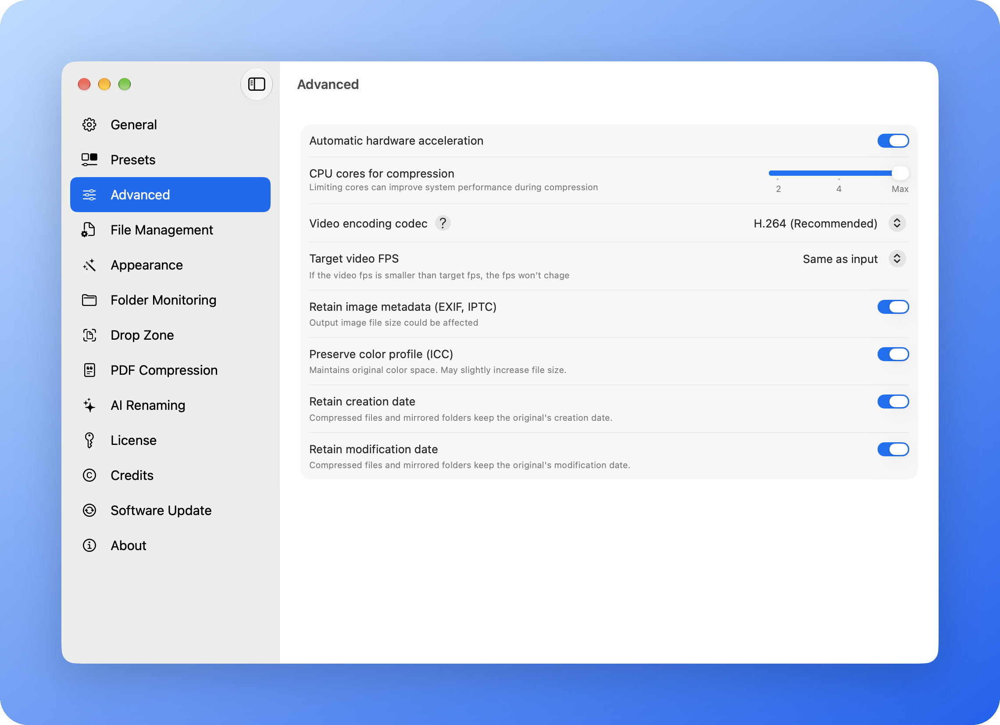

## Overview

With **Automatic hardware acceleration** on, Compresto lets FFmpeg pick the best hardware decoder on your Mac (such as Apple's VideoToolbox) to read your input videos. Decoding on dedicated hardware takes work off the CPU, which speeds up compression, especially for high-resolution H.264 and HEVC sources.

Encoding (writing the compressed video) still uses the [video codec](/customization/video-codec) you choose, so the output quality and file size are the same with this setting on or off.

## Benefits

- **Faster compression**: Less time spent decoding the source video
- **Lower CPU usage**: Frees up CPU time for encoding and for your other apps
- **Reduced heat**: Less CPU load means less heat and fan noise

## How It Works

Compresto checks what hardware decoding your Mac supports and uses it when it can. If a video can't be decoded in hardware, Compresto falls back to software decoding automatically. This works with:

- Apple Silicon Macs
- Intel Macs with integrated or discrete GPUs

## How to Configure

<Steps>
  <Step>
    Open Compresto
  </Step>
  <Step>
    Go to **Settings** > **Advanced**
  </Step>
  <Step>
    Toggle **Automatic hardware acceleration** on or off
    
  </Step>
</Steps>

## When to Disable

In most cases, hardware acceleration should be left on. However, you might want to turn it off if:

- A specific video fails to compress or shows visual glitches
- You encounter compatibility problems with certain video formats
