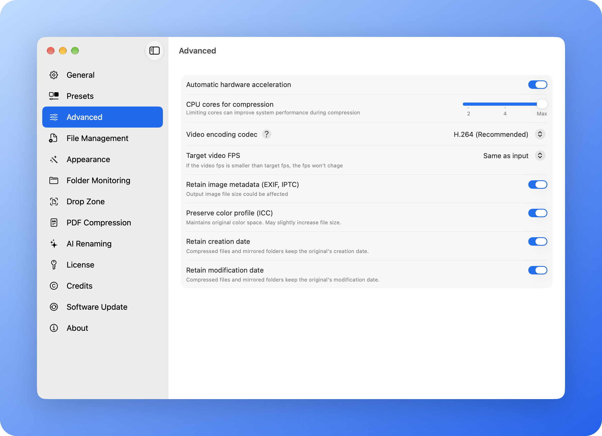

## Overview

Compresto allows you to choose the video encoding codec used during compression. The codec affects the compression efficiency, file size, and compatibility of your output videos.

## Available Codecs

| Codec | Description |
|-------|-------------|
| **H.264 (Recommended)** | Widely compatible codec supported by virtually all devices and platforms (default) |
| **H.265/HEVC** | Newer codec with better compression efficiency but limited compatibility |
| **H.266/VVC (Experimental)** | Smallest files, but much slower to encode, and most players can't open it yet |

<Note>
The codec applies to MP4 and MOV output. WebM output always uses VP9 video with Opus audio, whichever codec you pick.
</Note>

## Comparison

### H.264

- **Compatibility**: Excellent - works on almost all devices, browsers, and platforms
- **Compression**: Good compression with reliable quality
- **Processing speed**: Generally faster encoding
- **Best for**: General use, sharing online, maximum compatibility

### H.265/HEVC

- **Compatibility**: Limited - may not work on older devices or some browsers
- **Compression**: Better compression (smaller files at same quality)
- **Processing speed**: Slower encoding
- **Best for**: Archiving, when file size is critical, newer Apple devices

### H.266/VVC (Experimental)

- **Compatibility**: Very limited - macOS (QuickTime, Finder previews) and most players can't play H.266 yet
- **Compression**: The smallest files of the three at similar quality
- **Processing speed**: Much slower encoding
- **Best for**: Experiments and archives you'll play with a player that supports VVC

<Warning>
H.266/VVC only appears in the list when the installed FFmpeg can encode it. If it isn't supported, compression fails with **Your FFmpeg build doesn't support H.266/VVC encoding**. Switch back to H.264 or H.265.
</Warning>

## How to Configure

<Steps>
  <Step>
    Open Compresto
  </Step>
  <Step>
    Go to **Settings** > **Advanced**
  </Step>
  <Step>
    Select your preferred codec from the **Video encoding codec** dropdown
    
  </Step>
</Steps>

<Note>
H.264 is recommended for most users due to its wide compatibility. Only use H.265/HEVC if you specifically need smaller file sizes and your target devices support it. Use H.266/VVC only if you know your player supports it.
</Note>

## Learn More

For a detailed comparison of H.264 vs H.265, visit our [blog post](https://compresto.app/blog/h264-vs-h265).
