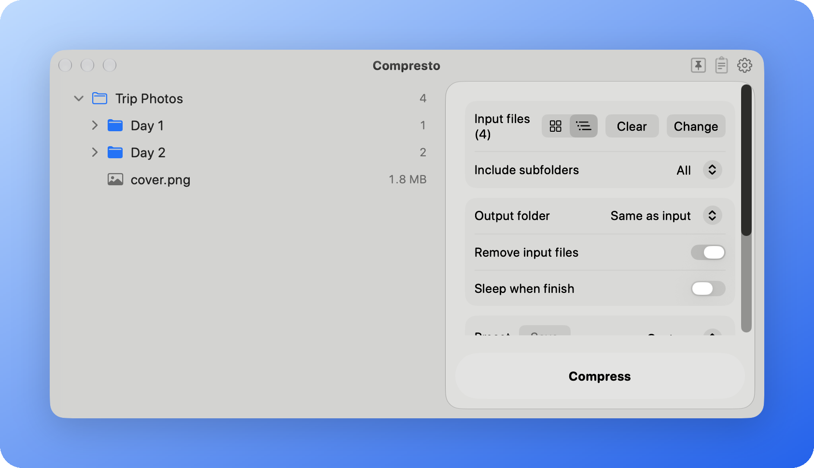

## Add Files

There are several ways to get files into the main window:

- Click the selection panel and choose files or folders
- Drag and drop files or folders onto the window
- Paste files or images you copied (**⌘V**)
- Right-click a file in Finder and choose **Open With** > **Compresto**
- Use a [deep link](/integrations/deep-linking) or the [Raycast extension](/integrations/raycast-extension)

You can drop or paste more files while a batch is running. They're added to the queue.

## Replace or Append

When you drop files on a window that already has files, Compresto replaces them by default. Change this in **Settings** > **File Management** > **On drop files and folders into main window**:

| Option | What happens |
|--------|--------------|
| **Replace current files** | The new files replace the current list (default) |
| **Append new files** | The new files are added to the current list |

Hold **Option** while dropping to do the opposite for that drop.

## Folders and Subfolders

When you add a folder, Compresto compresses every supported file inside it. Hidden files are skipped.

If the folder has subfolders, use **Include subfolders** in the sidebar to choose how deep to go:

| Option | Files included |
|--------|----------------|
| **None** | Only files directly in the folder |
| **Custom** | Files in subfolders up to the **Max depth** you set |
| **All** | Files in every subfolder |

The same choice is in **Settings** > **File Management** > **Include files in subfolders recursively**.

<Note>
With [Mirror folder](/guides/file-compression/output-options#mirror-folder) output, every subfolder is always included.
</Note>

## Filter by File Type

When you add a mix of file types, a **File types** picker appears in the sidebar. It lists how many images, videos, GIFs, PDFs, and EPUBs you added. Uncheck a type to leave those files out of the batch. At least one type always stays selected.

## Grid and Tree View

Use the **Grid** / **Tree** switch next to **Input files** to change how the list looks.

| View | Best for |
|------|----------|
| **Grid** | A few files. Shows a thumbnail preview for each file |
| **Tree** | Folders and large batches. Shows files in their folders with a live status |

Compresto switches to Tree view by itself when you drop folders or add more files than the **Thumbnail preview limit**. In Grid view with too many files, thumbnails are hidden and you can press **Show as tree**.

### Status in Tree View

Each file shows its progress while the batch runs:

- A spinner while the file is being compressed
- A check and the size saved when it's done
- **Original kept** when compressing didn't make the file smaller ([learn more](/guides/file-compression/output-options#original-kept))
- A failure mark if the file couldn't be compressed

Folders show how many of their files are done. Dropped folders are compressed one folder at a time.

While a batch runs, the tree follows the file being compressed. If you scroll away, press **Jump to current** to go back to it.

Right-click a file to **Show in Finder** or **Remove** it.

<Note>
[Per-file settings](/customization/per-file-settings) are only available in Grid view.
</Note>

### Thumbnail Preview Limit

Set **Settings** > **File Management** > **Thumbnail preview limit** to choose how many files can show thumbnails in Grid view. Type a number and press **Update**. Above this number, Compresto uses Tree view.

## Single File Preview

When you add one file, the main window shows a large preview instead of a grid. Hover over a video to see its format and size, and to [trim it](/guides/file-compression/how-to-trim-video).

## Remove Files

- Hover over a file in Grid view and click the remove button, or right-click it in Tree view and choose **Remove**
- Press **Clear** next to **Input files** to remove everything
- Press **Change** to pick a new set of files

You can remove files that are still waiting while a batch is running.
