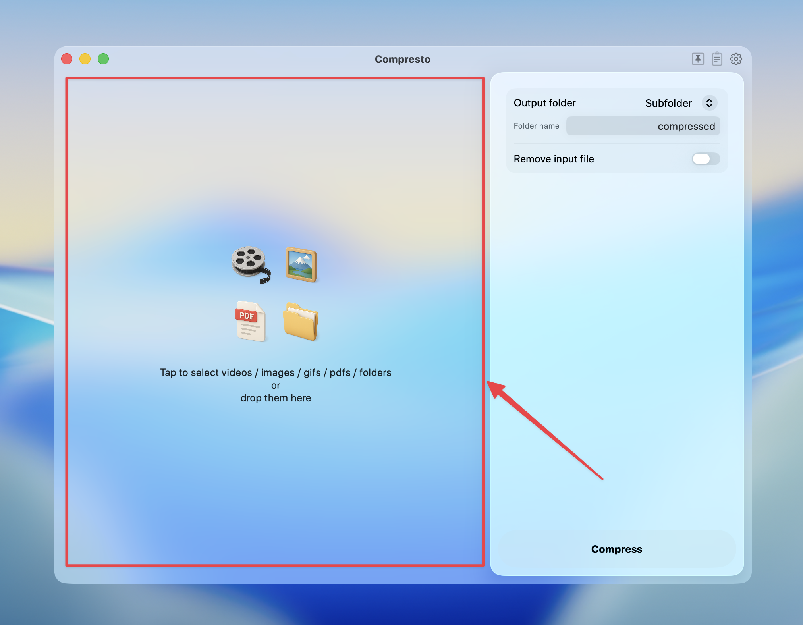
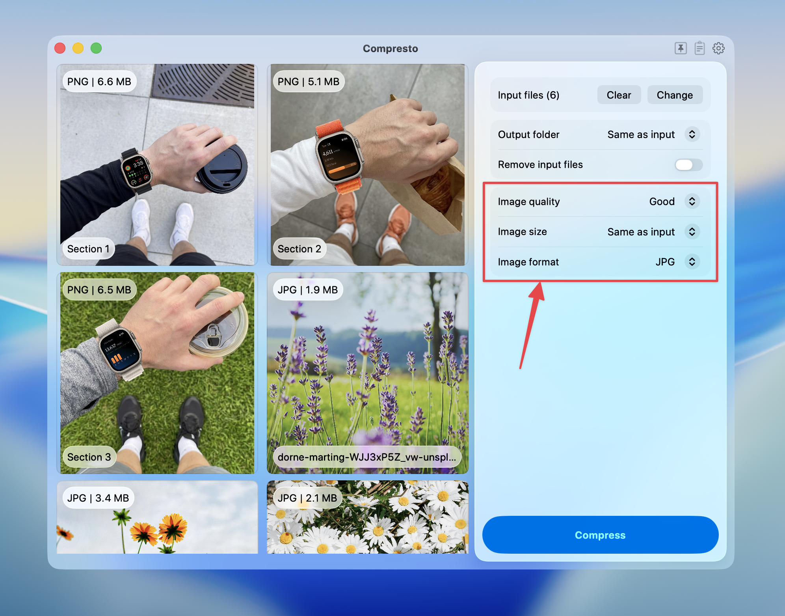
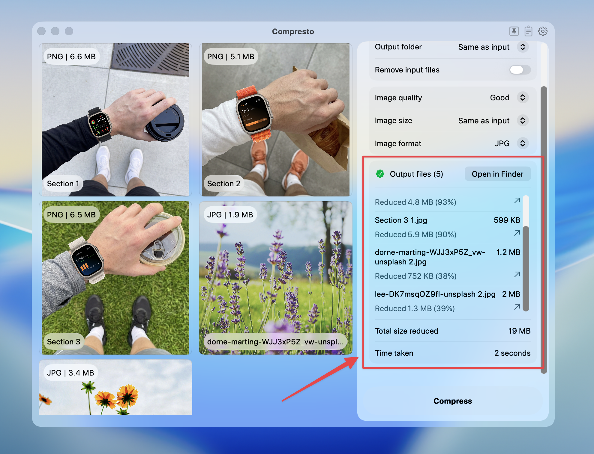

## Quick Start

<Steps>
  <Step>
    Click on the selection panel to select images, or drag and drop images/folders into it
    
  </Step>
  <Step>
    Adjust the image compression options
    
  </Step>
  <Step>
    Press **Compress** to start
    
  </Step>
  <Step>
    View compression results and open files in Finder
    
  </Step>
</Steps>

<Tip>
Choose where files are saved in [Output options](/guides/file-compression/output-options). If an image doesn't get smaller, Compresto keeps the original and shows **Original kept**, unless you changed its format.
</Tip>

## Compression Options

### Image Quality

| Quality | Description | Best For |
|---------|-------------|----------|
| **Highest** | Maximum quality, minimal compression | Archiving, print |
| **High** | Excellent quality | Professional use |
| **Good** | Good balance of quality and size | Web images |
| **Medium** | Moderate compression | Social media |
| **Acceptable** | Higher compression, smaller files | Thumbnails, previews |
| **Target file size** | Compress to a specific file size | Upload limits, email attachments |

### Target File Size

Choose **Target file size** to compress images to an exact size instead of a quality level. Enter the size and pick **KB**, **MB**, or **GB** (default 200 KB).

- Output is always saved as **JPG**, so the **Image format** picker is locked while this option is selected
- Compresto lowers the quality step by step until the file fits
- If an image can't get small enough, Compresto keeps the smallest version it could make and shows **Couldn't reach target size** next to that file

<Note>
Target file size is available in the main window, [presets](/customization/presets), and [per-file settings](/customization/per-file-settings). Drop Zone, folder monitoring, and deep links use quality levels instead.
</Note>

### Image Size

Resize images during compression:

| Option | Description |
|--------|-------------|
| **Same as input** | Keep original dimensions (default) |
| **Percentage** | Scale by percentage (e.g., 50% = half size) |
| **Max width** | Set maximum width in pixels |
| **Max height** | Set maximum height in pixels |
| **Max long edge** | Limit the longer dimension |
| **Max short edge** | Limit the shorter dimension |

<Note>
When resizing, aspect ratio is always preserved.
</Note>

### Image Format

| Format | Description | Best For |
|--------|-------------|----------|
| **Same as input** | Keep original format (default) | General use |
| **JPG** | Lossy compression, small files | Photos |
| **PNG** | Lossless, supports transparency | Graphics, screenshots |
| **WebP** | Modern format, excellent compression | Web images |
| **AVIF** | Newest format, best compression | Modern browsers |

## Supported Input Formats

Compresto supports compressing these image formats:
- JPG / JPEG
- PNG
- WebP
- AVIF
- HEIC / HEIF
- DNG
- TIFF
- BMP
- SVG (converted to JPG or PNG)

Animated GIFs have their own options — see [How to compress GIF](/guides/file-compression/how-to-compress-gif).

<Note>
JPEG and PNG output keeps the original print resolution (DPI), so compressed images place at the same size in layout apps. See [File metadata](/customization/file-metadata).
</Note>

## Tips for Best Results

- **For photos**: Use JPG format with "Good" or "High" quality
- **For graphics with transparency**: Use PNG or WebP format
- **For web optimization**: Use WebP format with "Good" quality
- **For maximum compression**: Use AVIF format (check browser support)
- **For batch resizing**: Use "Max long edge" to uniformly resize images
- **For strict upload limits**: Use "Target file size" to guarantee the file fits
