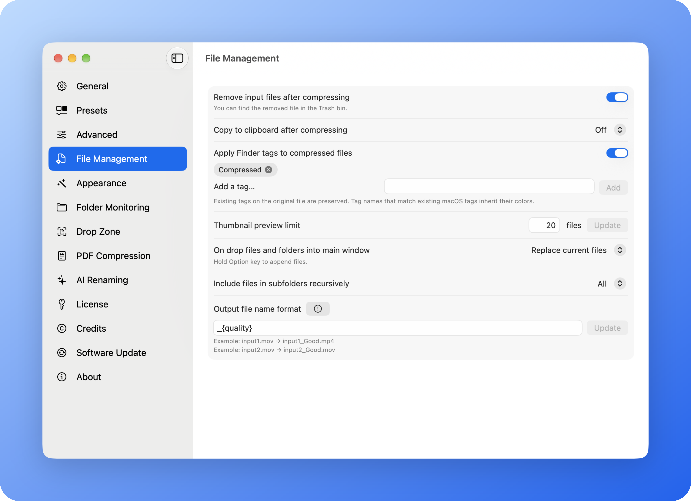

## Overview

The top of the main window's options sidebar controls what happens to your files after they're compressed:

| Option | What it does |
|--------|--------------|
| **Output folder** | Where compressed files are saved |
| **Remove input file(s)** | Moves the originals to the Trash after compressing |
| **Sleep when finish** | Puts your Mac to sleep when the batch is done ([learn more](/customization/sleep-after-compression)) |

## Output Folder

| Option | Where files go |
|--------|----------------|
| **Same as input** | Next to each original file (default) |
| **Subfolder** | In a subfolder next to each original. Type the **Folder name** (default `compressed`) |
| **Custom** | In one folder you choose. Press **Change** to pick another folder |
| **Mirror folder** | In a new copy of your folder tree. See [Mirror folder](#mirror-folder) below |

When a compressed file would replace an existing file with the same name, Compresto adds a number to the new file's name instead.

<Note>
[Drop Zone](/customization/drop-zone#output-folder) and [folder monitoring](/customization/folder-monitoring#output-folder) have their own output folder settings.
</Note>

## Mirror Folder

Mirror folder rebuilds the folder you compress inside a new folder, so you get a compressed copy of the whole tree while your source folder stays untouched.

<Steps>
  <Step>
    Set **Output folder** to **Mirror folder**
  </Step>
  <Step>
    Choose where to create the mirrored folder. It defaults to your **Desktop**. Press **Change** to pick another location
  </Step>
  <Step>
    Drop a folder into the main window and press **Compress**
  </Step>
</Steps>

Dropping a folder named `Trip` with the destination set to Desktop creates `Desktop/Trip` (or `Trip 2` if that name is taken) with the same subfolders inside.

- **Every file is included.** Mirror folder always reads all subfolders, so **Include subfolders** shows **All (mirror folder)**
- **Same names.** Compressed files keep their original names
- **Same number of files.** Files that aren't compressed (unsupported or filtered out), that don't get smaller, or that fail are copied as they are, so the mirror has the same folders and the same number of files as the source
- **Your source folder is never changed.** **Remove input files** is turned off and can't be turned on in this mode
- **Dates.** With **Retain creation date** or **Retain modification date** on, the mirrored folders keep the original folders' dates too ([learn more](/customization/file-metadata))

<Warning>
The destination can't be inside the folder you're compressing. If it is, Compresto asks you to choose a different destination.
</Warning>

<Note>
If [Drop Zone](/customization/drop-zone) uses **Last used settings** while the main window is set to Mirror folder, Drop Zone saves its files straight into the mirror destination without recreating the folder tree.
</Note>

## Original Kept

If compressing a file doesn't make it smaller, Compresto keeps the original instead, in every output mode:

- With **Same as input**, the original stays where it is
- With **Subfolder**, **Custom**, or **Mirror folder**, the original is copied into the output folder
- The original is never moved to the Trash, even with **Remove input file(s)** on
- The result shows **Original kept** instead of a negative size

This doesn't apply when you've asked for a different file: format conversions, trims, video to GIF, MP3 export, and removed audio always keep their output.

<Tip>
If the result says the input is already well-optimized, try a lower quality or a smaller resolution.
</Tip>

## Remove Input Files

Turn on **Remove input file(s)** to move the originals to the Trash after they're compressed. You can restore them from the Trash if you need them.

You can also set this in **Settings** > **File Management** > **Remove input files after compressing**. Both switches control the same setting.

<Note>
Originals are only removed when compression succeeds and the output is smaller. A kept original is never removed.
</Note>

## Output File Name Format

Go to **Settings** > **File Management** > **Output file name format** to add text to the end of every output file name. These variables are replaced when the file is saved:

| Variable | Replaced with |
|----------|---------------|
| `{timestamp}` | Current unix timestamp |
| `{datetime}` | Date and time in `yyyy-MM-dd'T'HHmmss` format |
| `{date}` | Date in `yyyy-MM-dd` format |
| `{time}` | Time in `HHmmss` format |
| `{quality}` | Quality of the output file |
| `{resolution}` | Resolution of the output file |

For example, `_{quality}` turns `input1.mov` into `input1_Good.mp4`. Press **Update** to save the format. The settings page shows two example names as you type.

<Note>
Folder monitoring can use a different format for each folder, and deep links can set one with `fileNameFormat`. See [Folder monitoring](/customization/folder-monitoring#output-file-name-format) and [Deep linking](/integrations/deep-linking).
</Note>

## Copy to Clipboard After Compressing

Go to **Settings** > **File Management** > **Copy to clipboard after compressing** to put the results on the clipboard when a batch finishes:

| Option | What's copied |
|--------|---------------|
| **Off** | Nothing (default) |
| **Files** | The output files, ready to paste into Finder or another app |
| **File paths** | The full path of each output file as text, one per line |

If you rename an output in the notch, the clipboard is updated with the new name.

<Note>
The **Files** / **File paths** choice is new after version 1.32. Earlier versions have a single on/off switch that copies the files.
</Note>

<Tip>
The notch also has a **Copy path** button after compression, so you can copy the output path without turning this setting on.
</Tip>

