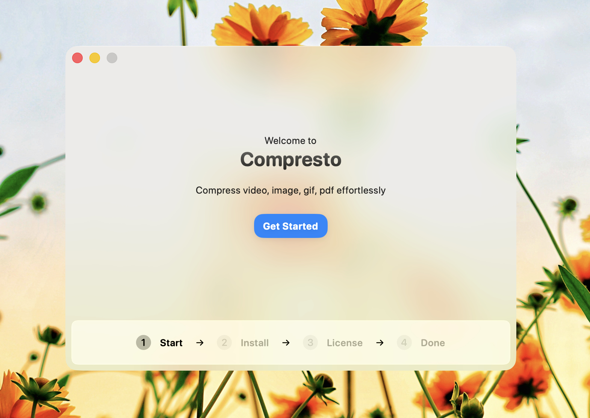
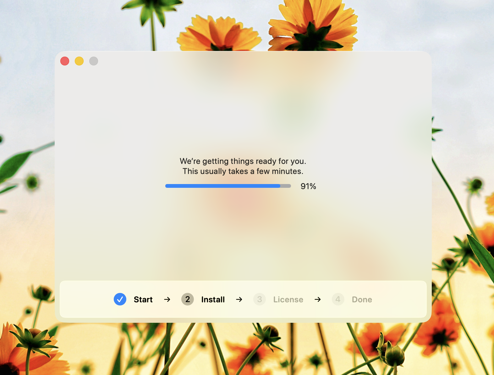
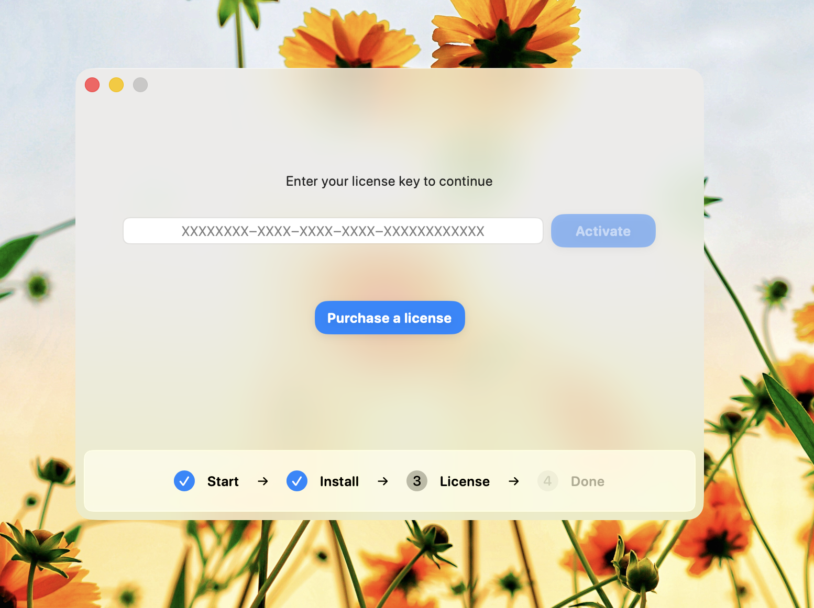
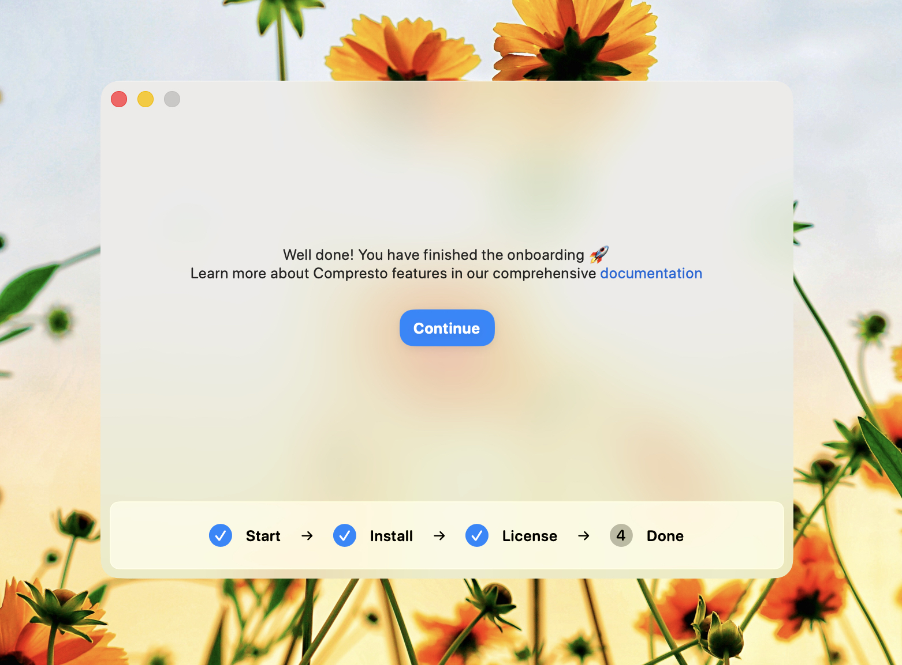

When you first launch Compresto, you'll be guided through a quick setup process.

<Steps>
  <Step title="Welcome">
    Choose your **Language** if you'd like to use Compresto in something other than your Mac's language, then press **Get Started** to begin the setup process.

    Changing the language asks you to restart Compresto. See [App language](/customization/language).

    
  </Step>
  <Step title="Installation">
    Compresto downloads and sets up its compression tools. This takes a few minutes, and you only do it once.

    A progress indicator shows the installation status. When you see **Compression tools are ready.**, press **Continue**.

    

    <Note>
    If you see **The setup didn't finish.**, press **Try Again** to retry. Make sure you have an active internet connection.
    </Note>
  </Step>
  <Step title="License Activation">
    Paste the license key from your purchase email and press **Activate**.

    

    <Info>
    **Don't have a license key?** Purchase one at [compresto.app/pricing](https://compresto.app/pricing)
    </Info>

    <Tip>
    **Setapp users**: Your license comes with Setapp. Simply press **Continue**.
    </Tip>
  </Step>
  <Step title="Done">
    You're ready to compress. The last screen shows a few guides to get more out of Compresto: Drop Zone, Presets, Folder Monitoring, Clipboard, and Video to GIF. Press **Read guide** on any of them to open it in your browser, or press **Start compressing** to open the main window.

    
  </Step>
</Steps>

## What Gets Installed

During the installation step, Compresto downloads these components:

- **FFmpeg** - For video and GIF processing. Apple Silicon Macs get a native arm64 build, so Rosetta isn't needed
- **Gifski** - For high-quality GIF creation
- **pngquant** - For PNG optimization

These tools are installed in a private folder and don't affect your system.

<Note>
PDF compression also needs **Ghostscript**, which is set up separately. If you use Homebrew, Compresto installs it for you automatically. Otherwise, see [Install Ghostscript](/guides/getting-started/install-ghostscript).
</Note>

## Troubleshooting

### Installation stuck or failed

1. Check your internet connection
2. Press **Try Again** to restart installation
3. If the issue persists, restart the app

### License activation failed

- Verify your license key is correct (format: XXXXXXXX-XXXX-XXXX-XXXX-XXXXXXXXXXXX)
- Check that you haven't exceeded the activation limit
- Ensure you have an active internet connection

### Need to redo setup

If you need to go through the setup again:
1. Open **Settings** > **About**
2. Press **Clear cache and reset onboarding**

Compresto moves its compression tools to the Trash and shows the setup screens again, so they are downloaded fresh, starting with the Welcome step. Your settings and license are kept.
